# Sơ đồ cơ sở dữ liệu Tizia

> Sinh tự động từ [`server/schema.sql`](../server/schema.sql) (PostgreSQL, 87 bảng).
> Cập nhật: 2026-10-09. Sinh lại khi schema đổi bằng script trong repo (hoặc nhờ Claude chạy lại).

## Cách đọc

- Đường **liền** `||--o{`: khoá ngoại **có ràng buộc thật** trong DB (`FOREIGN KEY`).
- Đường **đứt** `||..o{`: quan hệ **logic** — code tự nối, DB không ép ràng buộc (vd. `attempts.player_name` khớp `users.display_name`, `gpp_*` nối bằng mã SV).
- `PK` khoá chính · `FK` khoá ngoại/khoá nối · `UK` unique.
- Thời gian lưu dạng `bigint` (epoch ms/s); cờ boolean lưu `bigint 0/1`; nhiều cột `text` chứa JSON (`*_json`, `payload`, `body`, `props`…).
- Bảng `users` xuất hiện ở nhiều sơ đồ nhưng chỉ in đầy đủ cột ở nhóm 1; các nhóm khác chỉ hiện `id` để gọn.

## Tổng quan theo nhóm

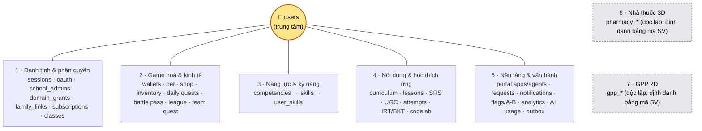

## 1 · Danh tính & phân quyền

Tài khoản, phiên đăng nhập, OAuth, quyền theo cấp học (domain), quan hệ phụ huynh–con, gói dịch vụ, lớp.

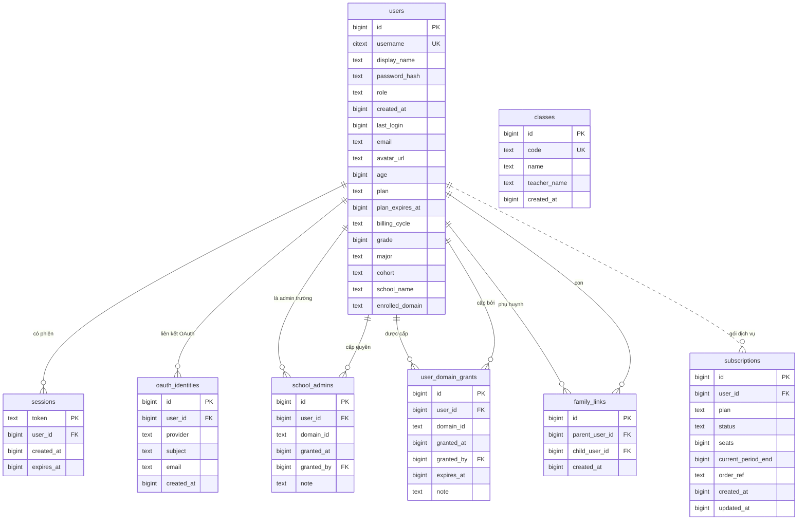

## 2a · Game hoá — ví, pet, cửa hàng, nhiệm vụ ngày

Ví XP/coin theo domain, pet, cửa hàng + kho đồ, streak/tim, nhiệm vụ ngày, huy hiệu.

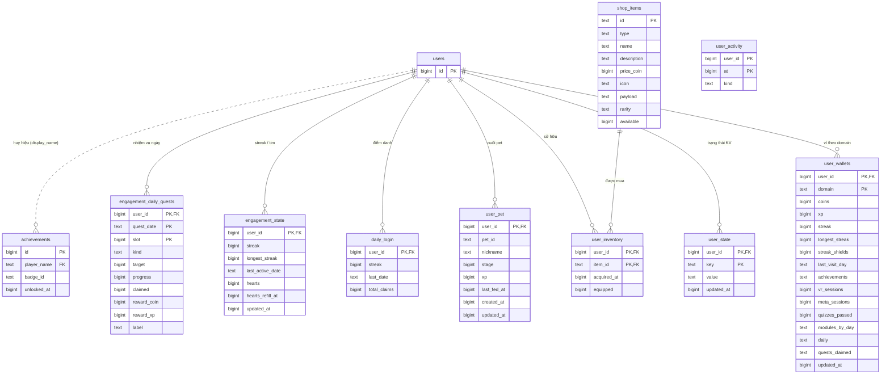

## 2b · Game hoá — thi đấu (Battle Pass, League, nhiệm vụ nhóm)

Battle Pass theo mùa, League hằng tuần (hạng/nhóm), nhiệm vụ nhóm theo lớp.

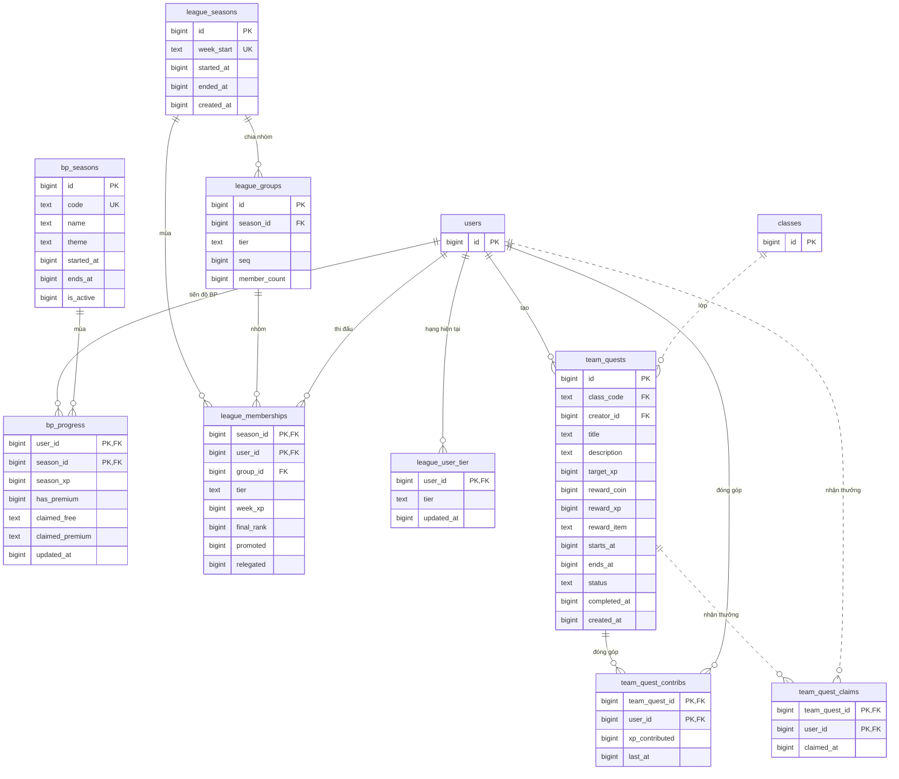

## 3 · Năng lực & kỹ năng (GDPT 2018)

15 năng lực → 207 kỹ năng, đồ thị tiên quyết, kỹ năng người học đạt được.

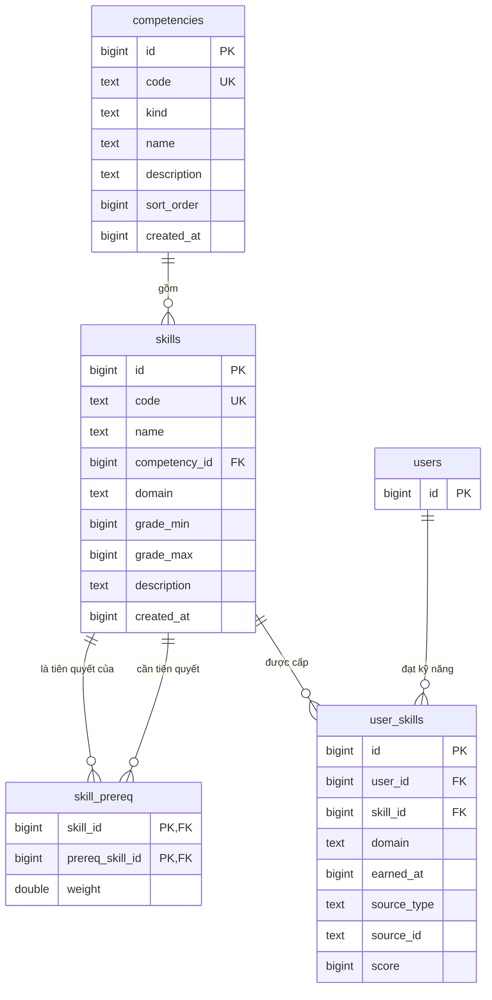

## 4a · Nội dung học & thẻ ghi nhớ (SRS)

Giáo trình/quiz nằm trong DB (curriculum_content, content_datasets), bài giảng cộng đồng, nội dung AI sinh, bộ thẻ SRS.

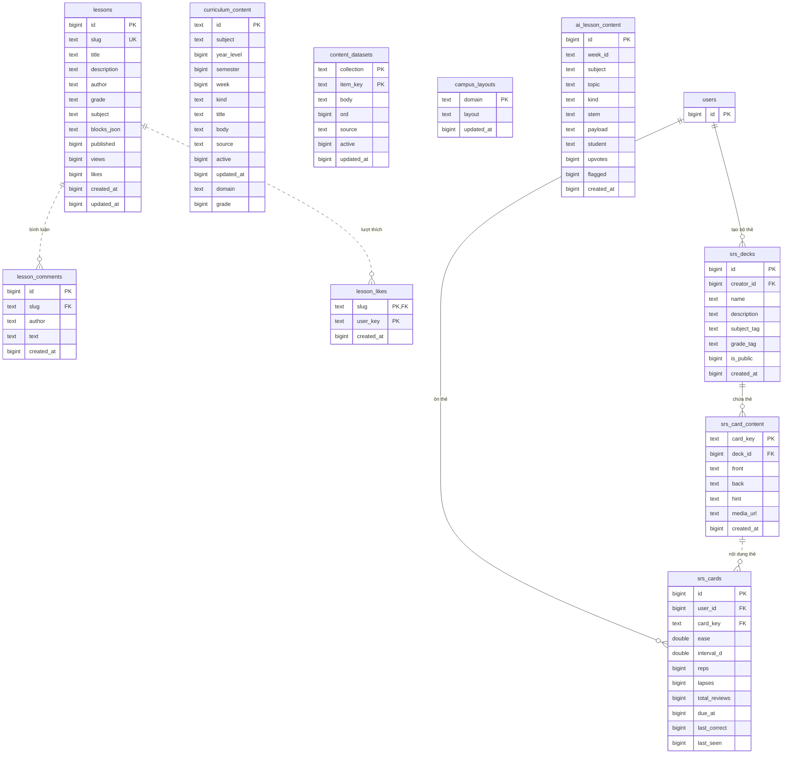

## 4b · Quest do người dùng tạo (UGC) & phòng live

Quest UGC kèm lượt chơi/thích/báo cáo; phòng thi đấu live theo mã PIN.

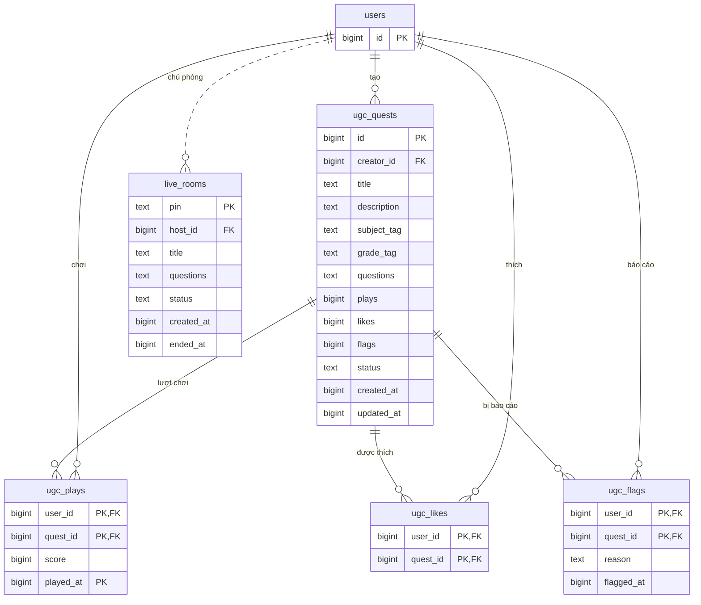

## 4c · Lượt làm bài & học thích ứng (IRT/BKT), Codelab

Lượt làm bài, câu hỏi qua ScoreUp, độ khó IRT, năng lực θ, BKT theo kỹ năng, sự kiện học, kịch bản, bài nộp Codelab.

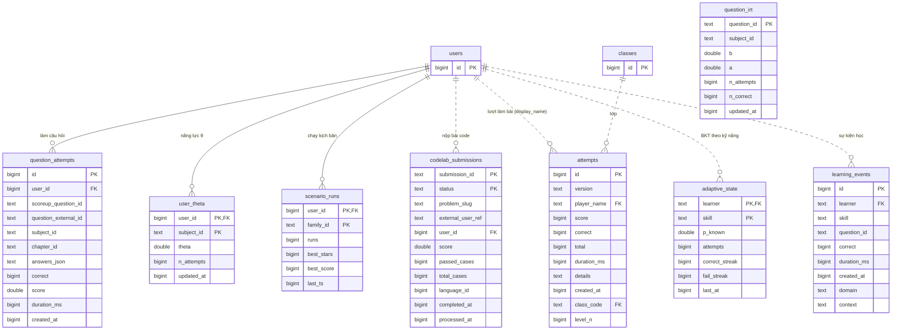

## 5a · Nền tảng — Portal App/Agent, yêu cầu SV, thông báo

App & Agent cài lên Tizia, hộp thư yêu cầu của SV + hội thoại + quyết định của Ban điều hành AI, thông báo và đăng ký push.

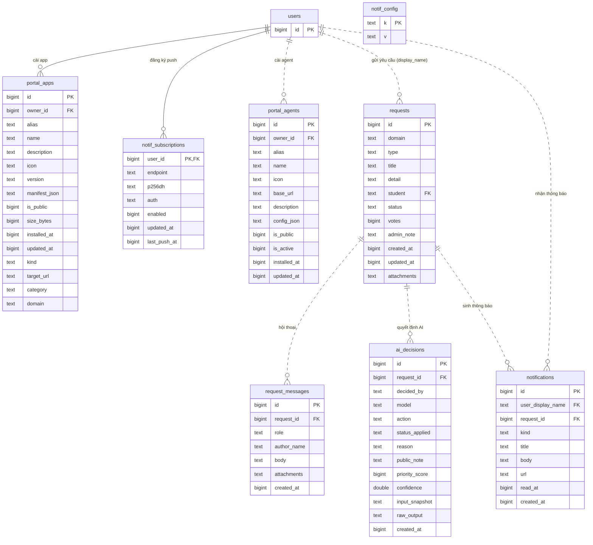

## 5b · Nền tảng — vận hành (flag, A/B, analytics, AI quota, webhook)

Feature flag, thí nghiệm A/B, analytics, log prompt + token AI, outbox/webhook ra ngoài, audit SQL của admin.

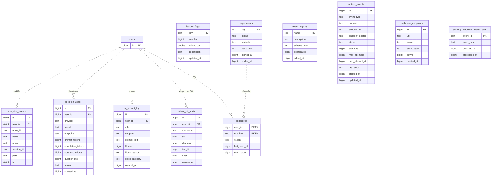

## 6 · Nhà thuốc 3D (PharmaComm)

Phiên thực hành, hội thoại, thao tác 3D, điểm A1..E5; hồ sơ SV và tài khoản giảng viên. Độc lập với users.

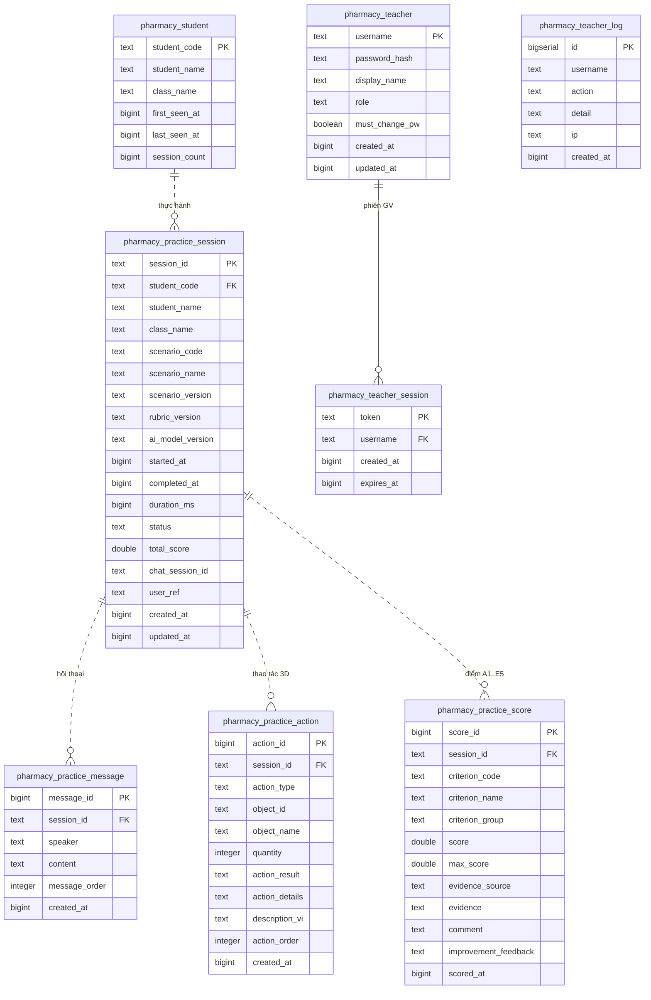

## 7 · Module GPP 2D (nghiên cứu)

Thực hành nghiệp vụ nhà thuốc GPP: người tham gia, phiên, nhật ký, kết quả cấp, pre/post test, khảo sát ARCS/CLT/SUS. Độc lập với users.

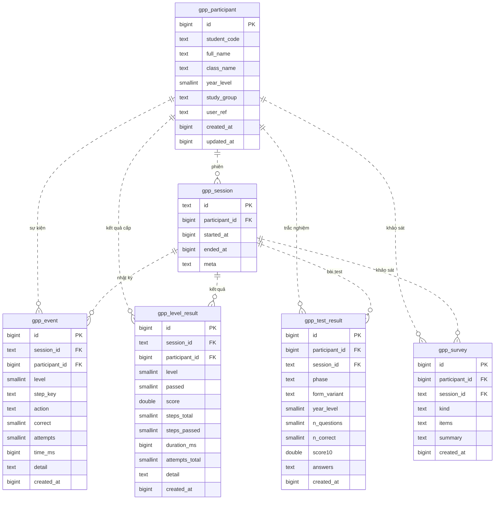

## Bảng độc lập (không quan hệ với bảng khác)

- `ai_lesson_content`
- `campus_layouts`
- `content_datasets`
- `curriculum_content`
- `event_registry`
- `feature_flags`
- `notif_config`
- `outbox_events`
- `question_irt`
- `scoreup_webhook_events_seen`
- `user_activity`
- `webhook_endpoints`
- `pharmacy_teacher_log`

## Ghi chú thiết kế

- **Không multi-tenant**: "trường" là `domain` (mầm non, tiểu học, THCS, THPT, đại học…), lưu dạng text ở `user_wallets.domain`, `user_skills.domain`, `curriculum_content.domain`, `portal_apps.domain`… chứ không có bảng `schools`.
- **Hai kiểu định danh**: phần lõi dùng `users.id` (FK thật); các bảng cũ/độc lập dùng chuỗi — `player_name`/`learner`/`student` (= `users.display_name`), hoặc `student_code` ở `pharmacy_*` và `gpp_*`.
- **Nội dung nằm ở DB**: `curriculum_content` (mỗi dòng = môn × tuần, `body` chứa cả câu hỏi + bài giảng) và `content_datasets` (collection/item_key) — không hardcode trong code.
- **Module có thể gỡ độc lập**: `pharmacy_*` và `gpp_*` không FK tới `users`; xoá module = drop các bảng cùng prefix.
